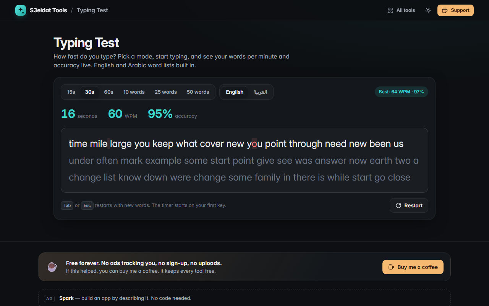

# Typing Test

> Measure your typing speed and accuracy in English or Arabic. Free, private, and it runs entirely in your browser.

### ▶ [Open Typing Test](https://s3eidat.github.io/typing-test/)



## Features

- **Time modes** (15, 30, 60 seconds) and **word modes** (10, 25, 50 words)
- Built-in **English** and **Arabic** word lists (Arabic types right-to-left)
- **Live WPM and accuracy** while you type; every character is coloured correct or wrong as you go
- Results with **net WPM**, **raw WPM**, accuracy, correct/wrong characters and your **most-missed keys**
- **Personal best** per mode and language, saved locally
- Restart instantly with <kbd>Tab</kbd> or <kbd>Esc</kbd>; the timer starts on your first key
- Fair word picks using the browser's cryptographic random generator

## Privacy

Your scores are saved only in your browser (localStorage). Nothing you type is stored or sent anywhere. There is no server, no account, no analytics.
The page ships with a strict Content-Security-Policy (`connect-src 'self'`), so the browser
itself blocks any attempt to send data anywhere.

## Run it yourself

It's plain HTML, CSS and JavaScript with no build step:

```bash
git clone https://github.com/s3eidat/typing-test
cd typing-test
python -m http.server 8000
```

Then open http://localhost:8000.

## Support

If this saved you time, **[buy me a coffee ☕](https://s3eidat.github.io/coffee/)**. It keeps every tool free.

---

Part of **[S3eidat Tools](https://s3eidat.github.io/)**: 100+ free, private tools that run in your browser. MIT licensed.
